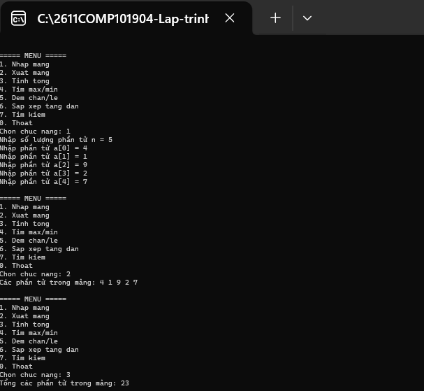
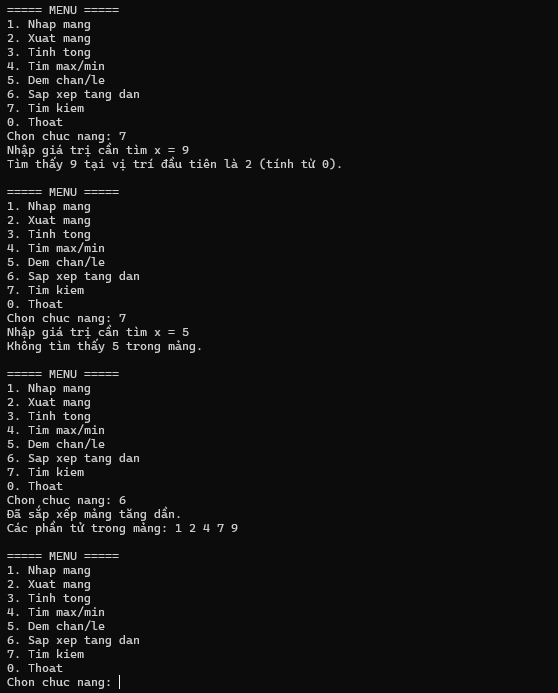
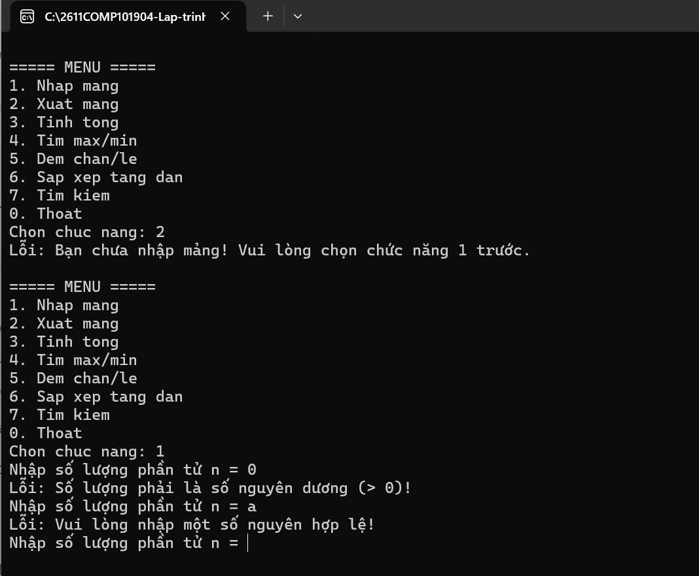

# Lab 02 - C# Cơ bản: Quản lý mảng số nguyên

## 1. Thông tin sinh viên
- **MSSV:** 49.01.103.025
- **Họ và tên:** Võ Nhật Song Hân

## 2. Mô tả bài tập
Xây dựng chương trình C# Console quản lý một mảng số nguyên. Chương trình sử dụng vòng lặp để tạo Menu tương tác liên tục cho đến khi người dùng chọn Thoát. Toàn bộ logic đã được tách khỏi hàm Main thành các phương thức (hàm) riêng biệt.

## 3. Các chức năng đã hoàn thành
- [x] **Nhập/Xuất mảng:** Bắt lỗi nhập liệu không cho nhập chữ, bắt buộc nhập n > 0.
- [x] **Tính toán cơ bản:** Tính tổng, tìm Max/Min, đếm số phần tử chẵn/lẻ.
- [x] **Xử lý mảng:** Sắp xếp mảng tăng dần, tìm kiếm vị trí phần tử x.
- [x] **Bắt lỗi giao diện:** Bắt buộc phải nhập mảng trước khi thao tác, cấu hình hiển thị tiếng Việt UTF-8.

## 4. Hình ảnh minh chứng (Test Case)

**Test case 1: Nhập mảng, Tính tổng, Tìm Max/Min, Đếm chẵn lẻ**

**Test case 2: Sắp xếp tăng dần và Tìm kiếm phần tử**

**Test case 3: Bắt lỗi khi nhập sai hoặc chưa nhập mảng**
