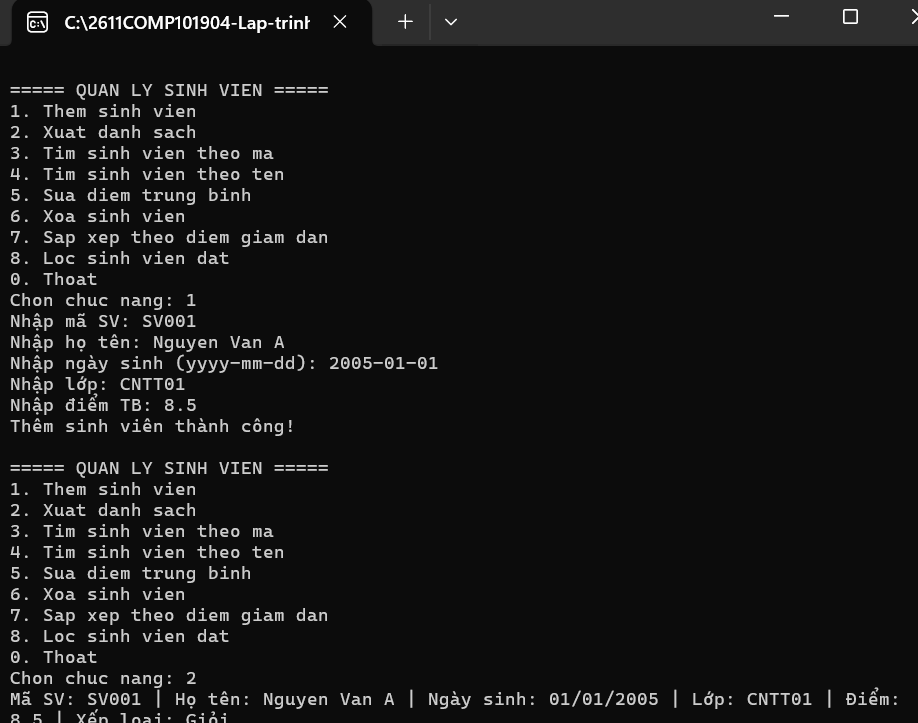
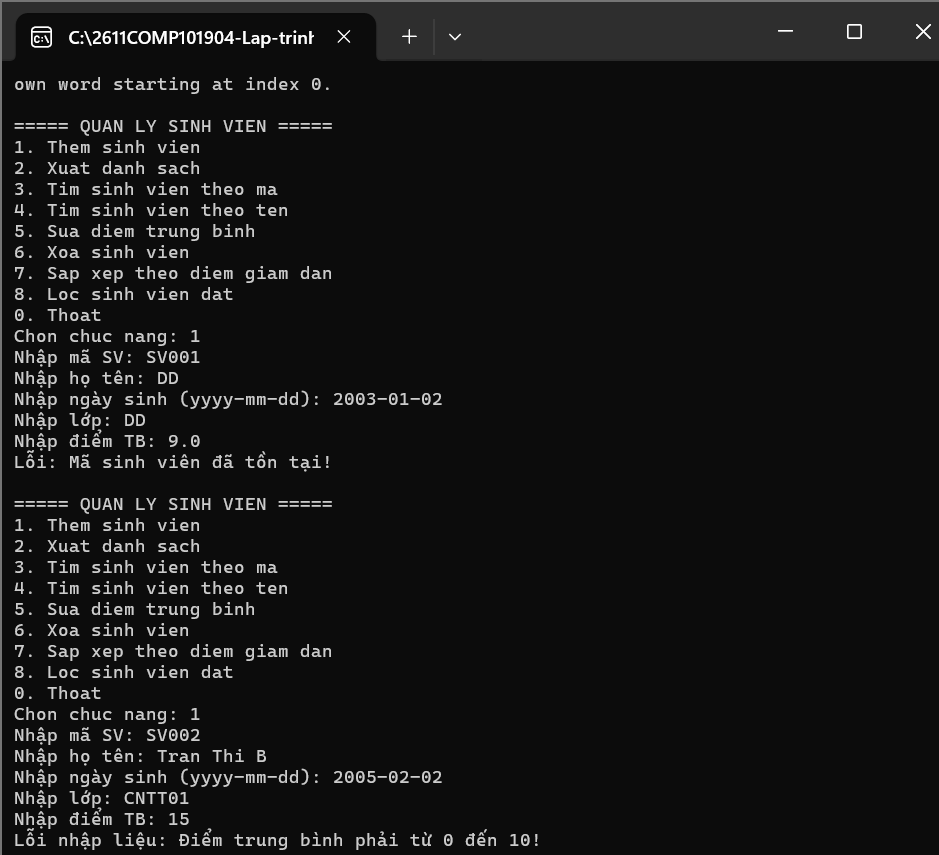
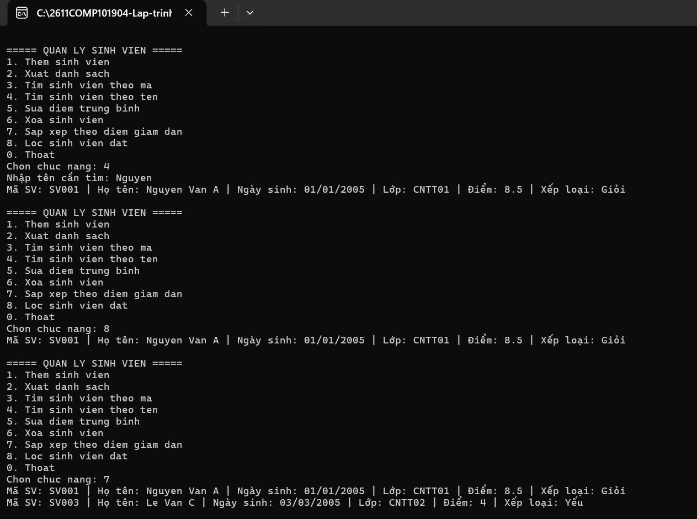

# Lab 03 - Quản lý sinh viên bằng Lập trình hướng đối tượng (OOP)

## 1. Thông tin sinh viên
- **MSSV:** 49.01.103.025
- **Họ và tên:** Võ Nhật Song Hân

## 2. Mô tả bài tập
Xây dựng chương trình Console quản lý sinh viên áp dụng các nguyên lý của Lập trình hướng đối tượng (OOP) trong C#[cite: 19]. Ứng dụng quản lý dữ liệu trong bộ nhớ bằng cấu trúc `List<SinhVien>` thông qua class `QuanLySinhVien` để tách biệt phần xử lý logic khỏi hàm Main[cite: 19].

## 3. Các chức năng đã hoàn thành
- [x] **Xây dựng Class & Kế thừa:** Tạo lớp cha `Nguoi` và lớp con `SinhVien` kế thừa từ `Nguoi`, áp dụng kỹ thuật Override cho phương thức `LayThongTin()`[cite: 19, 21].
- [x] **Quản lý danh sách (CRUD):** Thực hiện đầy đủ các chức năng Thêm, Xuất danh sách, Sửa điểm, Xóa sinh viên[cite: 20].
- [x] **Sử dụng LINQ:** Ứng dụng LINQ để tìm kiếm sinh viên theo tên, lọc danh sách sinh viên đạt (điểm >= 5.0) và sắp xếp danh sách theo điểm giảm dần[cite: 19, 20].
- [x] **Ràng buộc dữ liệu (Validation):**
  - Kiểm tra mã sinh viên không được trùng lặp khi thêm mới[cite: 20, 21].
  - Sử dụng Property để đảm bảo Điểm trung bình chỉ nhận giá trị trong khoảng từ 0 đến 10[cite: 19, 20, 21].
  - Bắt lỗi khi người dùng nhập sai kiểu dữ liệu để chương trình không bị dừng đột ngột[cite: 20].

## 4. Hình ảnh minh chứng (Test Cases)

**Test case 1: Thêm sinh viên thành công và xuất danh sách**

**Test case 2: Bắt lỗi nhập trùng mã sinh viên và điểm số không hợp lệ**
*(Kiểm tra khi nhập mã đã tồn tại hoặc nhập điểm < 0, > 10)*

**Test case 3: Lọc sinh viên đạt, sắp xếp và tìm kiếm bằng LINQ**
