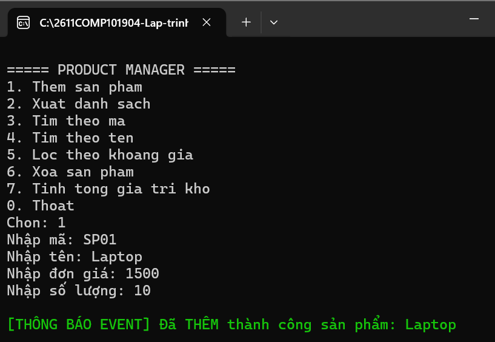
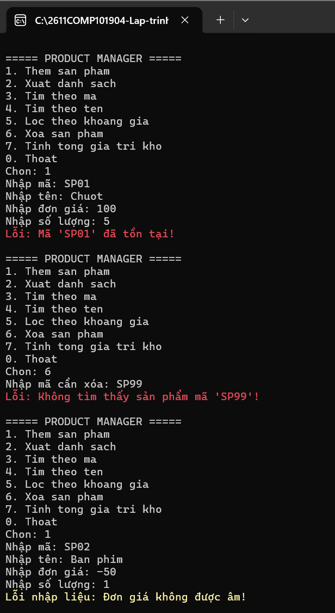
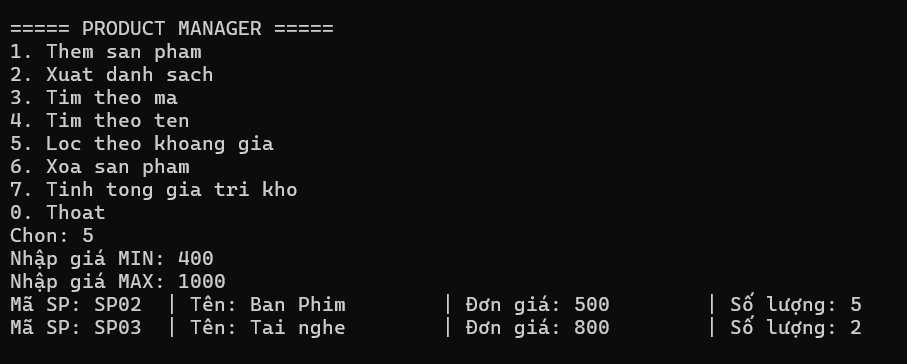

# Lab 04 - Exception, Event, Func và Generic Repository

## 1. Thông tin sinh viên
- **MSSV:** 49.01.103.025
- **Họ và tên:** Võ Nhật Song Hân

## 2. Mô tả bài tập
Ứng dụng quản lý sản phẩm bằng Console nâng cao. Ứng dụng triển khai mô hình kiến trúc cơ bản với Lớp dữ liệu (Generic Repository) và Lớp nghiệp vụ (Service)[cite: 22].

## 3. Các kỹ thuật đã áp dụng
- [x] **Generic & Interface:** Sử dụng `IEntity` để làm constraint cho class `Repository<T>` tái sử dụng mã nguồn[cite: 22].
- [x] **Custom Exception:** Xây dựng `DuplicateProductException` và `ProductNotFoundException` để bắt lỗi nghiệp vụ[cite: 22].
- [x] **Event / Action:** Sử dụng `Action<string> OnProductChanged` để phát tín hiệu thông báo (in chữ xanh) ra giao diện mỗi khi Thêm hoặc Xóa dữ liệu thành công[cite: 22].
- [x] **Func<T, bool> & LINQ:** Áp dụng Func để truyền điều kiện linh hoạt vào Repository (Tìm kiếm tên, Lọc theo khoảng giá)[cite: 22, 23].

## 4. Hình ảnh minh chứng (Test Cases)
**Test case 1: Thông báo sự kiện (Event) khi thêm sản phẩm**

**Test case 2: Try-Catch và ném lỗi Custom Exception**

**Test case 3: Lọc sản phẩm bằng Func**
