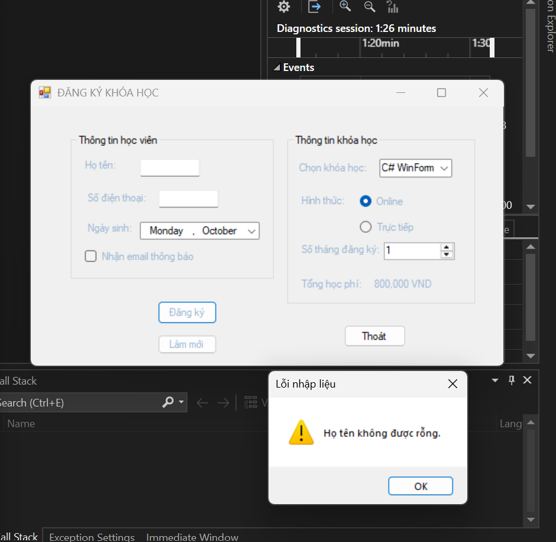
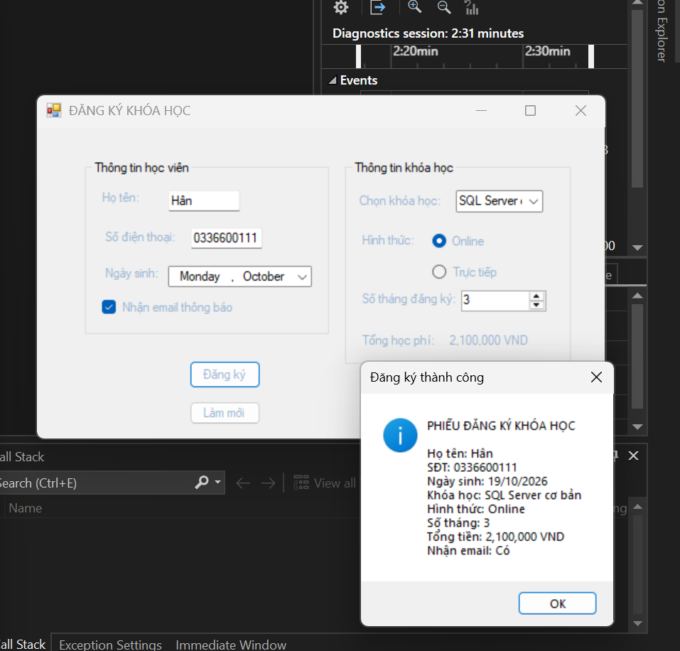

# Lab 05 - Windows Forms Cơ bản (Đăng ký khóa học)

## 1. Thông tin sinh viên
- **MSSV:** 49.01.103.025
- **Họ và tên:** Võ Nhật Song Hân

## 2. Các chức năng đã hoàn thành
- [x] Thiết kế giao diện đầy đủ các control (TextBox, ComboBox, NumericUpDown, RadioButton, CheckBox...)[cite: 24].
- [x] Đặt tên control đúng quy ước chuẩn mực[cite: 24].
- [x] Tự động tính toán tổng học phí dựa vào khóa học và số tháng đăng ký[cite: 25, 26].
- [x] Validation bắt lỗi bỏ trống thông tin[cite: 25].

## 3. Hình ảnh minh chứng (Test Cases)
**Bắt lỗi khi người dùng bỏ trống dữ liệu bắt buộc**

**Xử lý tính tiền và hiển thị phiếu đăng ký thành công**
