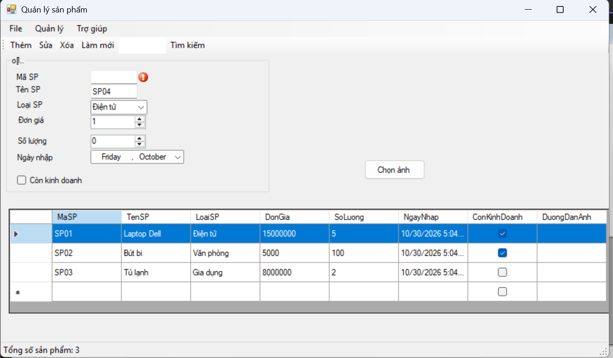
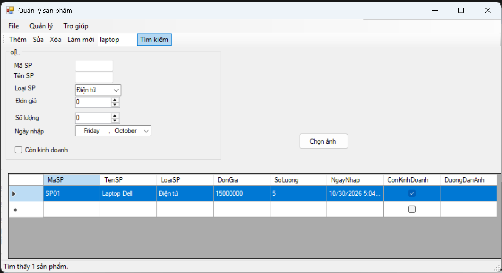

# Lab 06 - Advanced Windows Forms (Product Management)

## 1. Thông tin sinh viên
- **MSSV:** [Nhập Mã Số Sinh Viên của bạn]
- **Họ và tên:** [Nhập Họ và Tên của bạn]
- **Lớp:** [Nhập Tên Lớp của bạn]

## 2. Mô tả bài tập
Xây dựng ứng dụng Desktop Quản lý sản phẩm sử dụng C# .NET Framework WinForms tích hợp đầy đủ các thành phần điều khiển nâng cao, thanh công cụ, menu ngữ cảnh và xử lý dữ liệu bảng.

## 3. Các chức năng và kỹ thuật đã triển khai
- [x] **Quản lý dữ liệu với BindingList & DataGridView:** Đồng bộ dữ liệu hai chiều tự động giữa danh sách dữ liệu và bảng hiển thị, cho phép chọn dòng để xem chi tiết.
- [x] **Thanh công cụ (Menus & Toolbars):**
  - `MenuStrip`: Menu hệ thống chính (File, Quản lý, Trợ giúp).
  - `ToolStrip`: Thanh công cụ thao tác nhanh chứa các nút Thêm, Sửa, Xóa, Làm mới và ô Tìm kiếm.
  - `StatusStrip`: Thanh trạng thái hiển thị số lượng sản phẩm hiện có dưới đáy Form.
- [x] **Menu ngữ cảnh (ContextMenuStrip):** Tích hợp menu chuột phải ngay trên DataGridView để thao tác Sửa/Xóa nhanh.
- [x] **Kiểm tra dữ liệu (ErrorProvider):** Bắt lỗi nhập liệu không hợp lệ (Mã/Tên rỗng, Đơn giá/Số lượng không hợp lệ) với hiệu ứng cảnh báo trực quan.
- [x] **Xử lý hình ảnh (OpenFileDialog & PictureBox):** Cho phép người dùng duyệt ảnh từ máy tính và hiển thị hình ảnh sản phẩm.

## 4. Báo cáo kết quả thử nghiệm (Test Cases)

### Test case 1: Cảnh báo bắt lỗi nhập liệu
Kiểm tra tính năng Validate dữ liệu bằng ErrorProvider khi người dùng bỏ trống ô dữ liệu hoặc nhập sai quy định:

### Test case 2: Thêm mới sản phẩm có ảnh & Menu ngữ cảnh
Kiểm tra thêm mới sản phẩm thành công, hiển thị hình ảnh và mở ContextMenuStrip khi click chuột phải vào bảng:

### Test case 3: Tìm kiếm sản phẩm
Kiểm tra tính năng lọc danh sách sản phẩm theo từ khóa và cập nhật thanh StatusStrip dưới đáy:
(images/test-xoa.png)