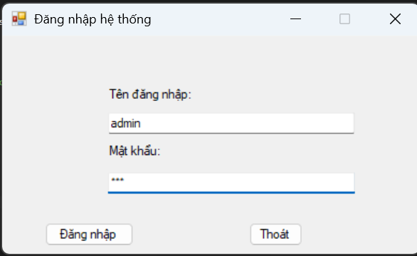
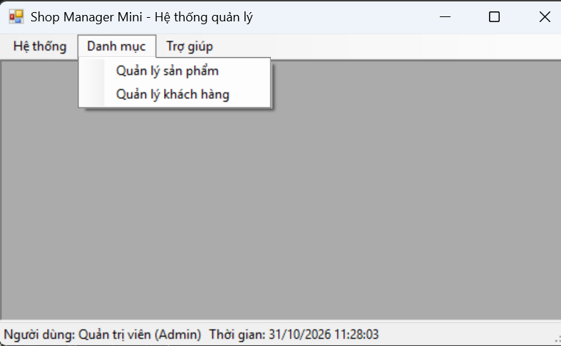
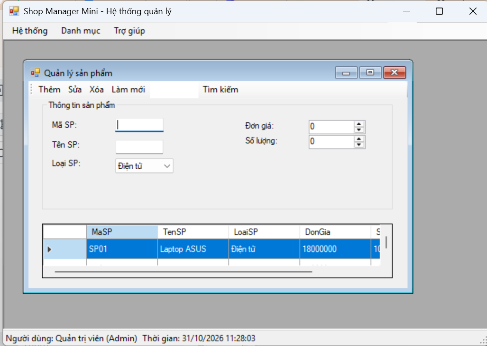
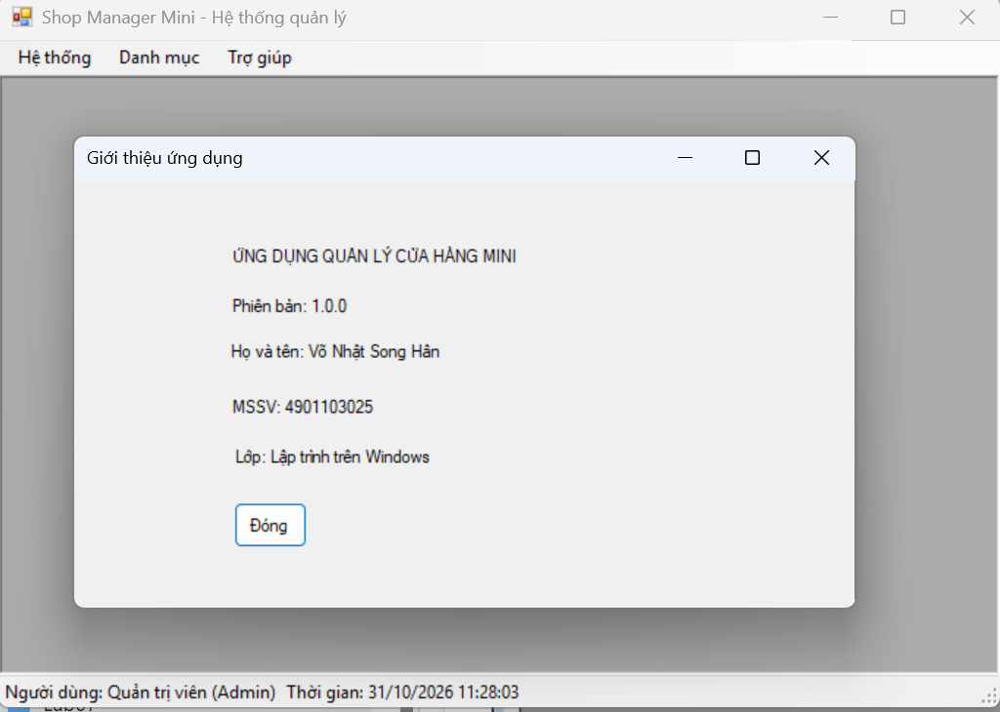

# Lab 07 - SDI, MDI và Ứng dụng nhiều Form trong C# WinForms (ShopManagerMini)

## 1. Thông tin sinh viên
- **MSSV:** 4901103025
- **Họ và tên:** Võ Nhật Song Hân
- **Tên dự án:** `Lab07` (`ShopManagerMini`)

---
## 2. Báo cáo kết quả thử nghiệm (Test Cases)
### Test case 1: Màn hình Đăng nhập


### Test case 2: Màn hình chính MDI Parent & Quản lý nhiều Form con


### Test case 3: Màn hình Quản lý Sản phẩm (CRUD & DataGridView)


### Test case 4: Màn hình Giới thiệu (FrmAbout)



## 3. Câu hỏi
1. SDI và MDI khác nhau như thế nào?
SDI (Single Document Interface): Mỗi cửa sổ (Form) hoạt động hoàn toàn độc lập trên không gian làm việc của hệ điều hành. Khi mở Form mới, nó xuất hiện thành một cửa sổ riêng biệt trên thanh Taskbar.

MDI (Multiple Document Interface): Có một cửa sổ chính đóng vai trò làm Form cha (IsMdiContainer = true). Tất cả các Form con (MdiChildren) chỉ được phép hiển thị và di chuyển bên trong vùng làm việc của Form cha này.

2. Vì sao Form đăng nhập nên dùng ShowDialog()?
ShowDialog() mở Form dưới dạng Modal Dialog (hộp thoại chặn tương tác). Phương thức này sẽ tạm dừng việc thực thi code phía sau cho đến khi Form đóng lại. Điều này bắt buộc người dùng phải hoàn thành việc đăng nhập xác thực thành công (hoặc bấm Thoát) thì chương trình mới tiếp tục mở màn hình chính (FrmMain).

3. Trong bài lab này, dữ liệu user được truyền từ FrmLogin sang FrmMain bằng cách nào?
Dữ liệu được truyền qua thuộc tính CurrentUser của FrmLogin. Sau khi đăng nhập thành công, FrmLogin gán đối tượng User tìm thấy vào CurrentUser và trả về DialogResult.OK. Trong file Program.cs, dữ liệu này được lấy ra và truyền trực tiếp qua Constructor nhận tham số User của FrmMain (new FrmMain(frmLogin.CurrentUser)).

4. Nếu người dùng bấm menu sản phẩm nhiều lần, chương trình xử lý như thế nào để không mở trùng Form?
Hàm OpenMdiChildForm<T>() sử dụng vòng lặp duyệt qua danh sách tất cả Form con đang mở của Form cha (this.MdiChildren).

Nếu tìm thấy một Form đã mở thuộc đúng kiểu dữ liệu T (ví dụ FrmProduct), chương trình sẽ gọi phương thức child.Activate() để đưa Form đó lên trên cùng và lệnh return dừng lại không khởi tạo Form mới.

5. Khi nào nên dùng constructor, khi nào nên dùng property để truyền dữ liệu giữa các Form?
Dùng Constructor: Khi dữ liệu là bắt buộc phải có để Form khởi tạo và hoạt động bình thường (ví dụ: thông tin User đăng nhập truyền vào FrmMain).

Dùng Property: Khi dữ liệu là tùy chọn, không bắt buộc có ngay lúc khởi tạo, hoặc cần cập nhật thay đổi nhiều lần linh hoạt trong quá trình Form đang hoạt động.
## 4. Mô tả ứng dụng & Cấu trúc dự án

### 4.1. Mô tả tổng quan
Ứng dụng **ShopManagerMini** được thiết kế theo kiến trúc **MDI (Multiple Document Interface)** cho phép quản lý nhiều cửa sổ chức năng bên trong một Form chính. Hệ thống hỗ trợ đăng nhập phân quyền, quản lý danh mục Sản phẩm và Khách hàng trong bộ nhớ (`BindingList<T>`), ngăn ngừa việc mở trùng lặp các Form con và tích hợp các công cụ kiểm tra dữ liệu, thanh trạng thái, đồng hồ thời gian thực.

### 4.2. Cấu trúc cây thư mục (Solution Structure)
```text
Lab07/
├── Models/
│   ├── User.cs
│   ├── Product.cs
│   └── Customer.cs
├── Forms/
│   ├── FrmLogin.cs
│   ├── FrmMain.cs
│   ├── FrmProduct.cs
│   ├── FrmCustomer.cs
│   └── FrmAbout.cs
├── images/
│   ├── test-login.png
│   ├── test-main-mdi.png
│   ├── test-product.png
│   ├── test-customer.png
│   └── test-about.png
├── Program.cs
├── Lab07.csproj
└── README.md


