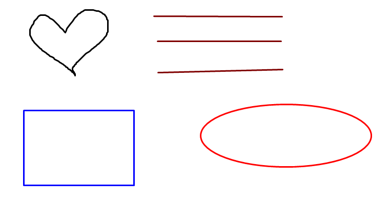

# Lab 08 - Simple Paint (WinForms & GDI+)

## 1. Thông tin sinh viên
- **MSSV:** 49.01.103.025
- **Họ và tên:** Võ Nhật Song Hân
- **Tên dự án:** `COMP1019_Lab08_SimplePaint`

## 2. Mô tả ứng dụng
Ứng dụng Paint đơn giản được xây dựng bằng C# WinForms và thư viện đồ họa GDI+ cho phép người dùng tương tác vẽ hình trực tiếp trên màn hình thông qua các thao tác sự kiện chuột (`MouseDown`, `MouseMove`, `MouseUp`).

## 3. Các chức năng và kỹ thuật đã hoàn thành
- [x] **Vẽ 4 chế độ cơ bản:** Pen (bút tự do), Line (đường thẳng), Rectangle (hình chữ nhật), Ellipse (hình elip/tròn).
- [x] **Tùy chỉnh nét vẽ:** Chọn màu bằng `ColorDialog` và thay đổi độ dày nét vẽ qua `NumericUpDown`.
- [x] **Quản lý vùng vẽ linh hoạt:**
  - Lưu trữ toàn bộ đối tượng vẽ trong `List<DrawItem>`.
  - Thực hiện vẽ lại trong sự kiện `Paint` của Canvas để chống mất nét vẽ khi resize hoặc bị che cửa sổ.
  - Sử dụng custom Panel `DrawSurface` có `DoubleBuffered = true` để chống nhấp nháy màn hình khi kéo chuột.
- [x] **Thao tác bổ trợ:** Nút **Undo** (hoặc phím tắt **Ctrl + Z**) để xóa nét vẽ gần nhất và **Clear** để xóa toàn bộ vùng vẽ.
- [x] **Chức năng nâng cao:** Xuất toàn bộ nội dung vẽ ra file hình ảnh PNG (`SaveFileDialog`).

## 4. Kết quả thử nghiệm
