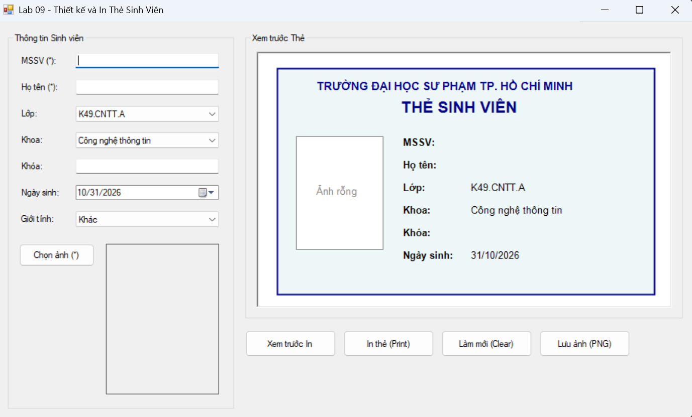
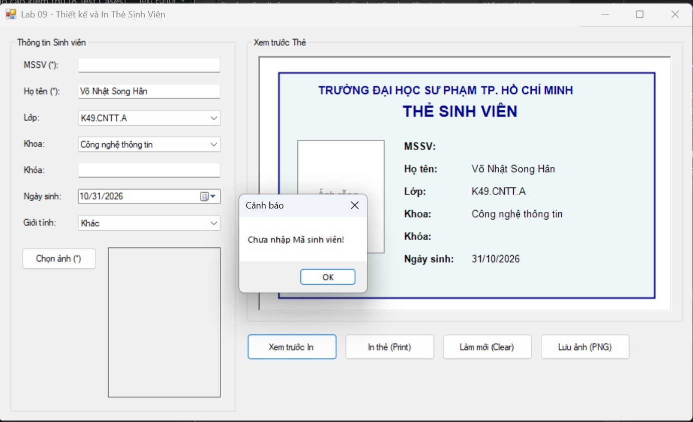
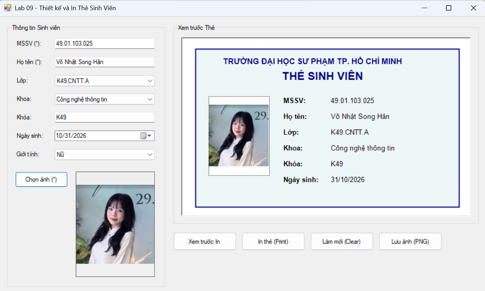
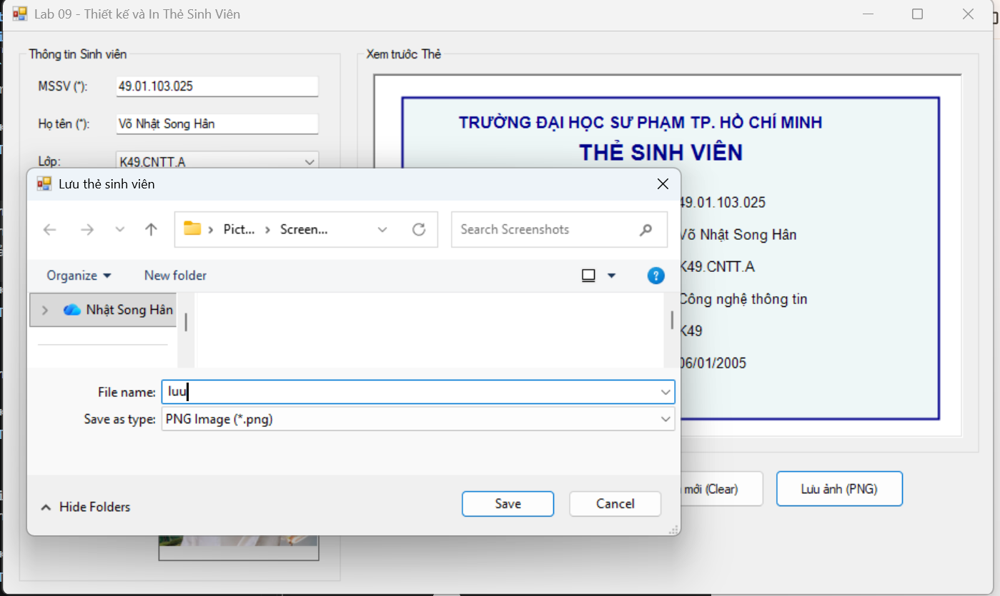
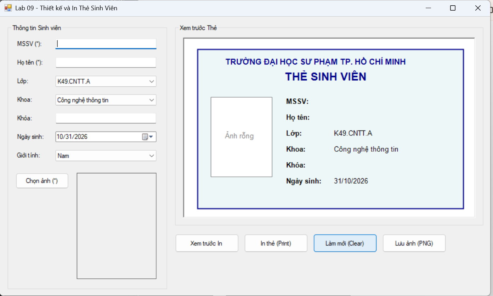
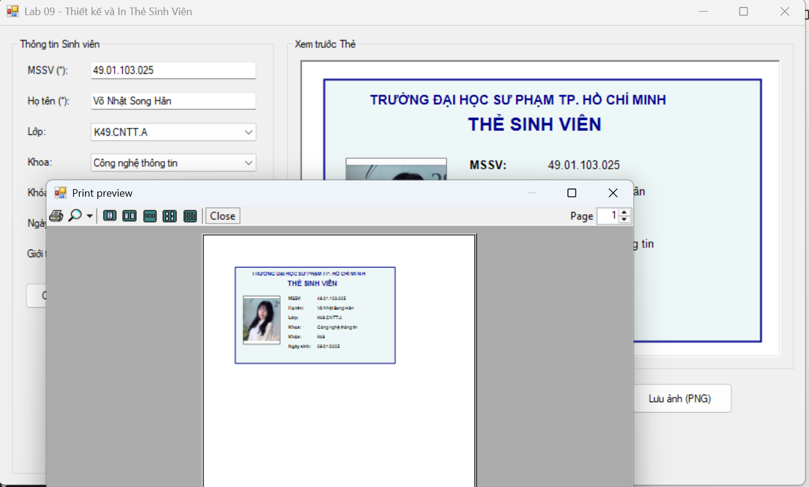
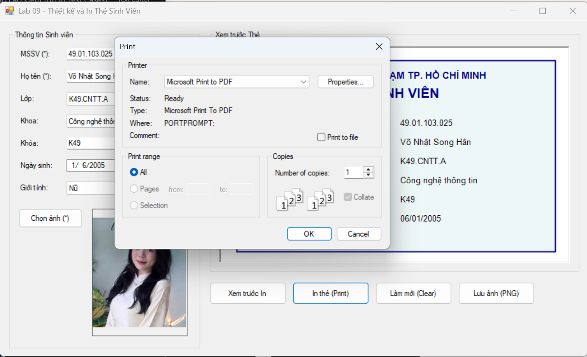

# Lab 09 - Thiết kế và In Thẻ Sinh Viên bằng WinForms

## 1. Thông tin sinh viên
- **MSSV:** 49.01.103.025
- **Họ và tên:** Võ Nhật Song Hân


## 2. Mô tả và Cách chạy chương trình
- **Mô tả:** Ứng dụng Windows Forms sử dụng GDI+ để vẽ bản xem trước thẻ sinh viên dựa trên dữ liệu người dùng nhập vào, hỗ trợ chọn ảnh đại diện an toàn và tích hợp công cụ `PrintDocument` để xem trước bản in và in thẻ.
- **Cách chạy chương trình:** 
  1. Mở file Solution `Lab09.sln` bằng Visual Studio.
  2. Nhấn phím `F5` (hoặc nút `Start`) để biên dịch và chạy ứng dụng.
  3. Nhập thông tin, chọn ảnh đại diện (.jpg, .png) để xem bản vẽ thẻ trên Panel.
  4. Bấm "Xem trước In" hoặc "In thẻ (Print)" để sử dụng chức năng in ấn.

## 3. Các chức năng đã triển khai
- [x] Validation dữ liệu bắt buộc (Mã SV, Họ tên, Ảnh).
- [x] Chọn và hiển thị ảnh đại diện bằng `OpenFileDialog` (ảnh không bị méo, không bị lỗi khóa file).
- [x] Cập nhật bản vẽ thẻ tự động (real-time) trên Panel bằng GDI+ khi người dùng thay đổi dữ liệu.
- [x] Tích hợp `PrintPreviewDialog` để xem trước thẻ trước khi in.
- [x] Tích hợp `PrintDocument` và `PrintDialog` để in thẻ.
- [x] Chức năng mở rộng: Lưu thẻ sinh viên thành file ảnh PNG.

## 4. Báo cáo kiểm thử (8 Test Cases)

**TC01 - Hiển thị Form:** Mở ứng dụng, Form chính hiển thị đúng kích thước, Combobox có sẵn danh sách mẫu.
> **Minh chứng:**
> 

**TC02 - Validation lỗi bỏ trống:** Bấm "Xem trước in" khi chưa nhập dữ liệu -> Hệ thống chặn lại và hiện thông báo lỗi.
> **Minh chứng:**
> 

**TC03 - Chọn ảnh hợp lệ:** Bấm "Chọn ảnh", nạp file `.jpg` -> Ảnh hiển thị đúng tỷ lệ (Zoom) trên PictureBox và trên Panel vẽ thẻ.
> **Minh chứng:**
> 

**TC04 - Đổi ảnh liên tục:** Thay đổi ảnh đại diện 2-3 lần liên tiếp -> Ứng dụng không bị treo, ảnh trên Form cập nhật chính xác.
> **Minh chứng:**
> 

**TC05 - Lưu ảnh thẻ:** Bấm "Lưu ảnh (PNG)" 
> **Minh chứng:**
> 

**TC06 - Làm mới:** bấm "Làm mới", toàn bộ Form xóa sạch dữ liệu và ảnh để nhập lại từ đầu.
> **Minh chứng:**
> 

**TC07 - Xem trước bản in:** Nhập đủ dữ liệu hợp lệ, bấm "Xem trước in" -> Cửa sổ `PrintPreviewDialog` hiện lên với kích thước chuẩn, hiển thị rõ nét thẻ sinh viên trên trang giấy.
> **Minh chứng:**
> 

**TC08 - In thẻ :** Bấm "In thẻ", chọn máy in PDF ảo để xuất file thành công.
> **Minh chứng:**
> 

## 5. Cấu trúc thư mục dự án
```text
Lab09/
├── Lab09.sln
├── Lab09.csproj
├── Program.cs
├── StudentCardInfo.cs
├── FrmStudentCard.cs
├── README.md
└── images/
    ├── tc01-hienthi.png
    ├── tc02-loibotrong.png
    ├── tc03-anhhople.png
    ├── tc04-saifile.png
    ├── tc05-doianh.png
    ├── tc06-realtime.png
    ├── tc07-xemtruoc.png
    └── tc08-invalammoi.png