# README – Lab 10: EduManagerDB

**Môn học:** COMP1019 – Lập trình trên Windows  
**Chủ đề:** Thiết kế và cài đặt cơ sở dữ liệu EduManagerDB bằng SQL Server

## 1. Mục tiêu
- Thiết kế cơ sở dữ liệu quan hệ quản lý sinh viên.
- Tạo database, bảng, khóa chính, khóa ngoại và các ràng buộc bằng T-SQL.
- Nhập dữ liệu mẫu đúng quan hệ giữa các bảng.
- Thực hiện truy vấn `SELECT`, `JOIN`, `GROUP BY`, `UPDATE`, `DELETE`.
- Kiểm thử các ràng buộc dữ liệu.

## 2. Cấu trúc cơ sở dữ liệu
Cơ sở dữ liệu `EduManagerDB` gồm 6 bảng:
- `KHOA`: thông tin khoa.
- `LOP`: thông tin lớp, tham chiếu `KHOA`.
- `SINHVIEN`: thông tin sinh viên, tham chiếu `LOP`.
- `MONHOC`: thông tin môn học.
- `KETQUA`: điểm của sinh viên theo môn, tham chiếu `SINHVIEN` và `MONHOC`.
- `TAIKHOAN`: tài khoản đăng nhập demo.

Các ràng buộc chính:
- Điểm trong `KETQUA` nằm trong khoảng 0–10.
- Giới tính trong `SINHVIEN` chỉ nhận `Nam` hoặc `Nữ`.
- Số tín chỉ trong `MONHOC` phải lớn hơn 0.

## 3. Cách chạy
Chạy các tệp SQL trong SQL Server Management Studio (SSMS) theo thứ tự:
1. `01_CreateDatabase.sql`
2. `02_InsertSampleData.sql`
3. `03_Queries.sql`

Sau khi chạy, kiểm tra kết quả trong cửa sổ **Results** và chụp ảnh màn hình. Nếu chạy lại từ đầu, cần xử lý database cũ theo hướng dẫn của giảng viên trước khi tạo lại.

## 4. Danh sách 12 truy vấn và ảnh minh chứng

> **Cách chèn ảnh:** lưu ảnh chụp kết quả trong thư mục `images/` theo đúng tên bên dưới. GitHub sẽ hiển thị ảnh ngay trong README. Các ảnh hiện là khung chờ để bạn thay bằng ảnh chụp thực tế từ SSMS; không dùng ảnh minh họa giả làm kết quả chạy.

### Truy vấn 1 – Liệt kê toàn bộ sinh viên
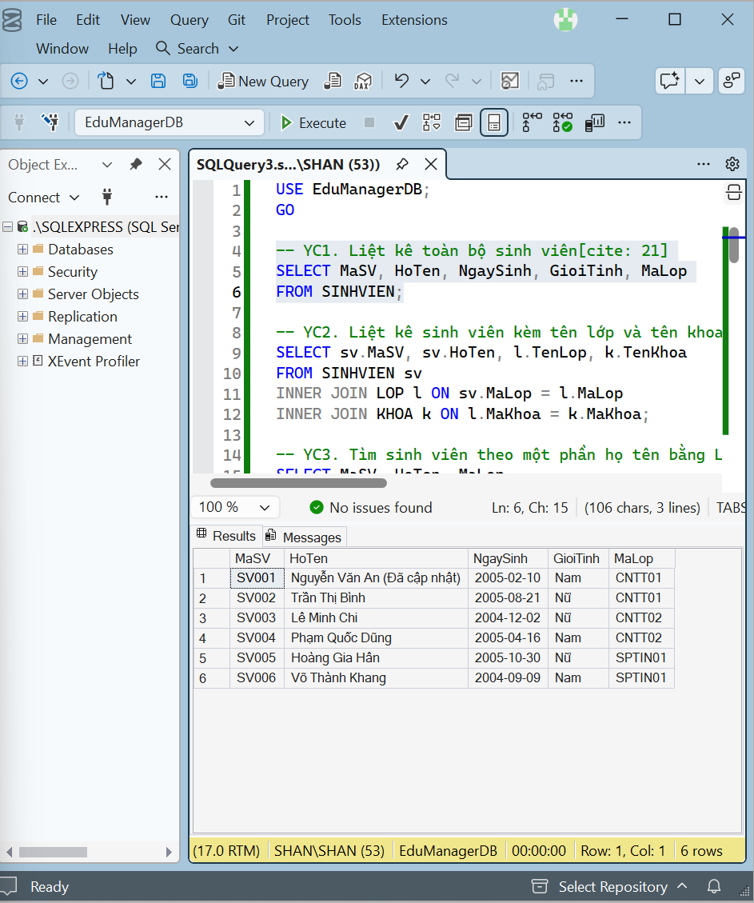

### Truy vấn 2 – Sinh viên kèm tên lớp và tên khoa
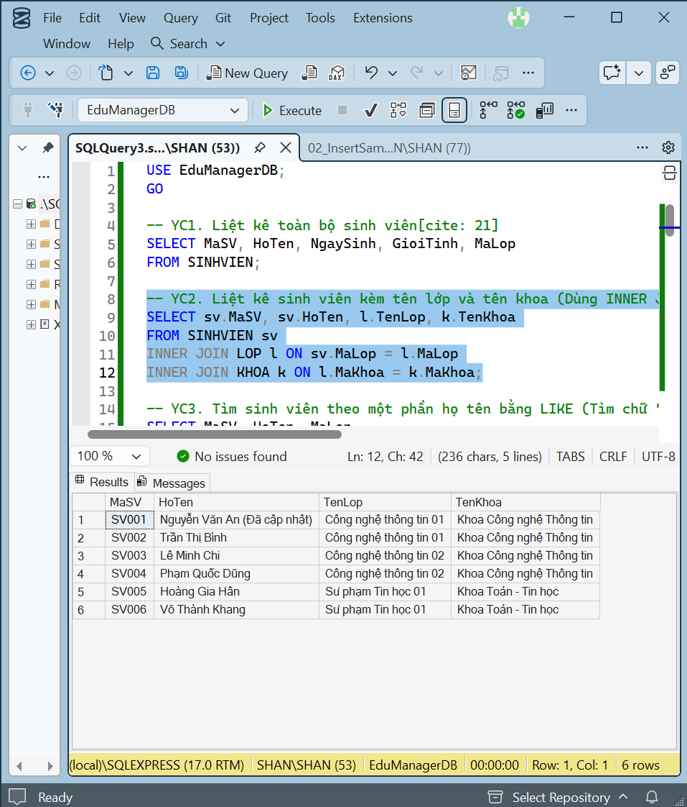

### Truy vấn 3 – Tìm sinh viên theo một phần họ tên bằng LIKE
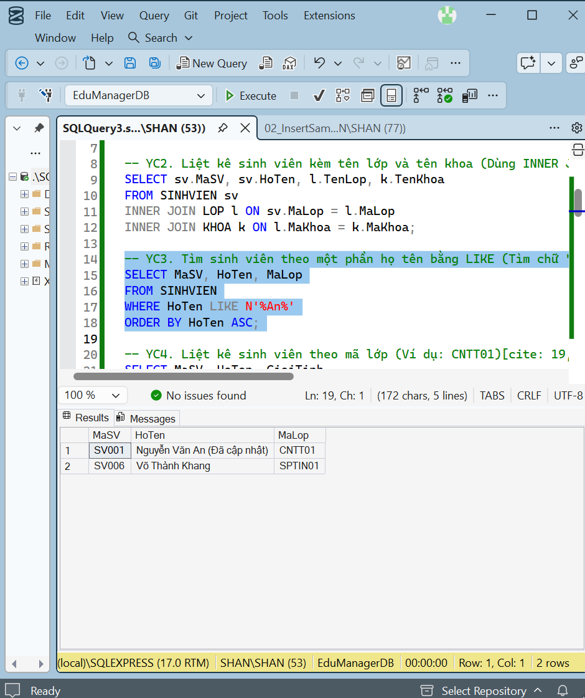

### Truy vấn 4 – Liệt kê sinh viên theo mã lớp
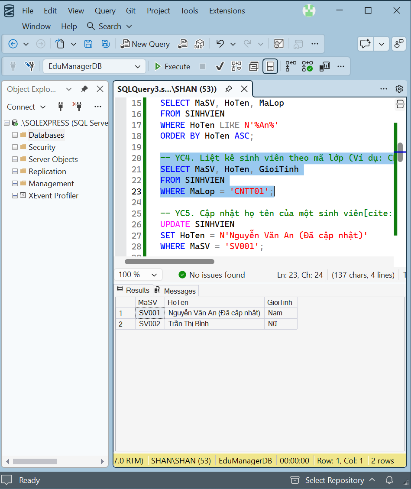

### Truy vấn 5 – Cập nhật họ tên hoặc lớp của một sinh viên
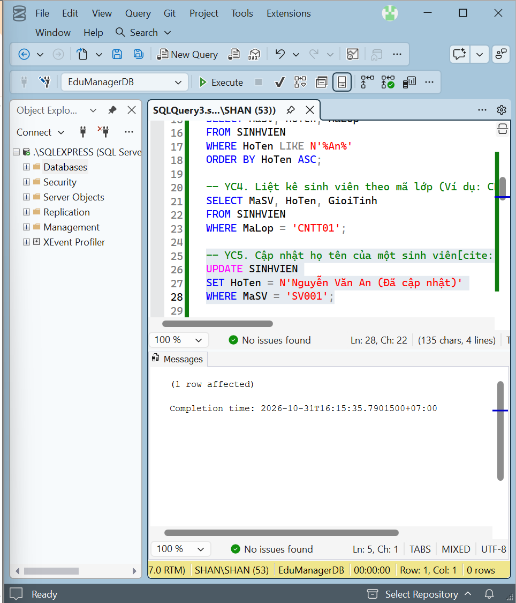

### Truy vấn 6 – Xóa một sinh viên chưa có dữ liệu điểm
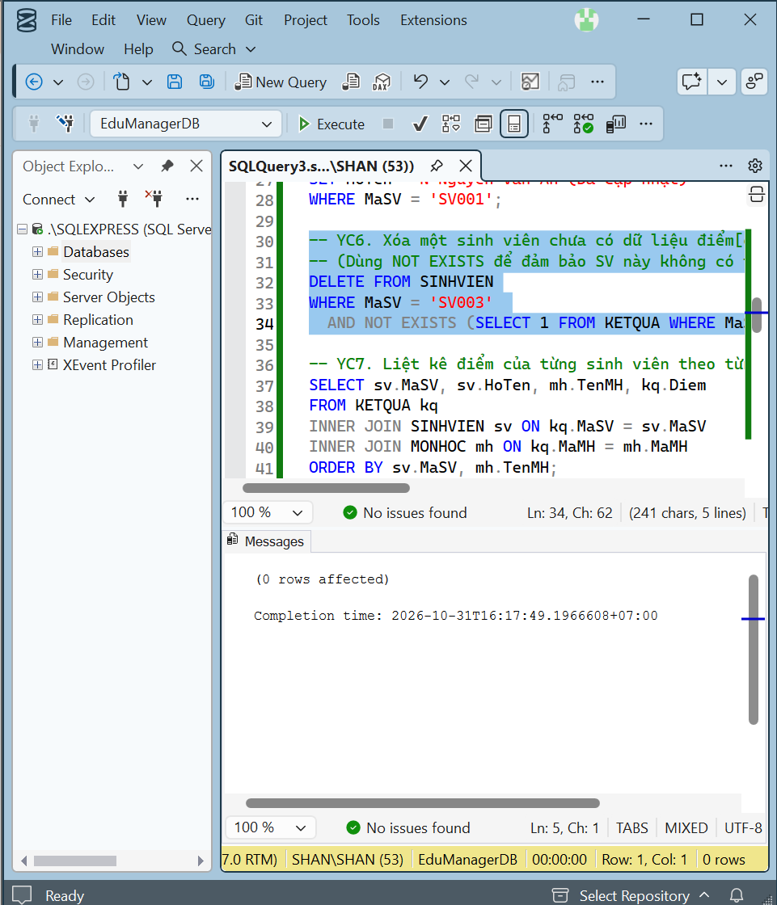

### Truy vấn 7 – Liệt kê điểm của từng sinh viên theo từng môn
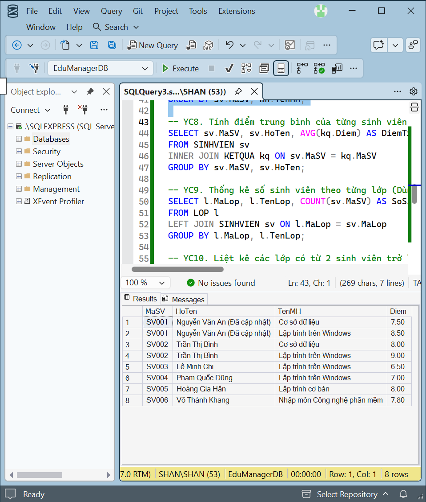

### Truy vấn 8 – Tính điểm trung bình của từng sinh viên
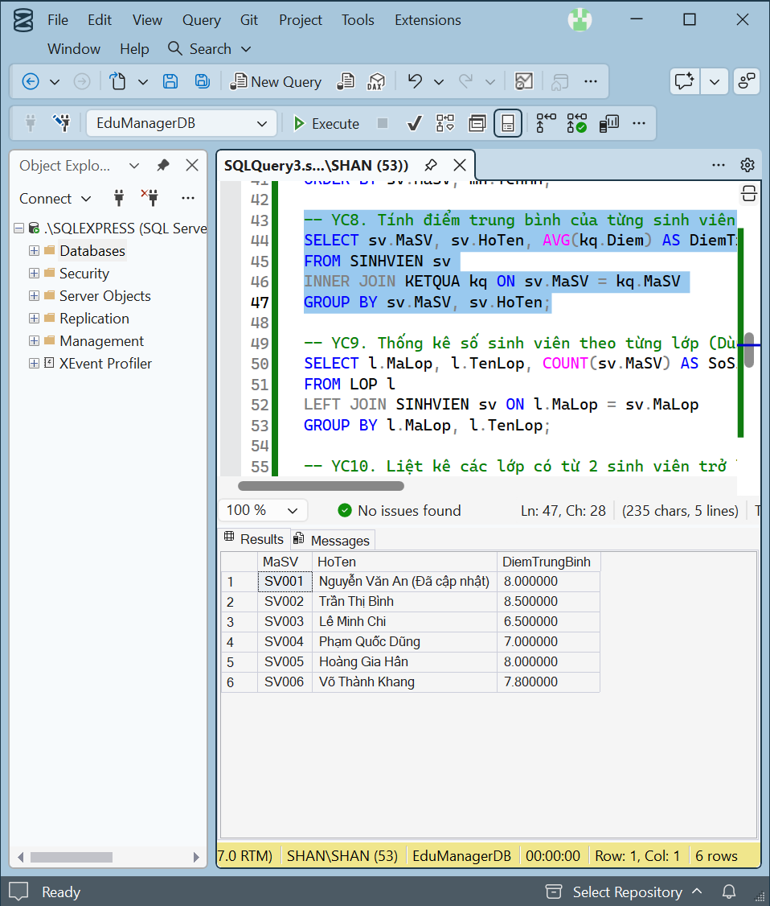

### Truy vấn 9 – Thống kê số sinh viên theo từng lớp
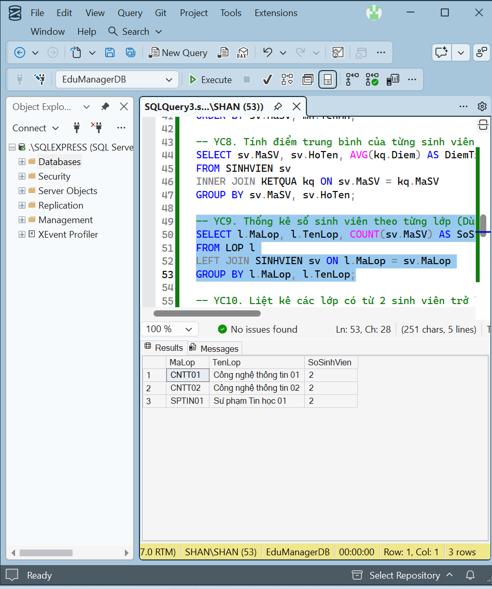

### Truy vấn 10 – Liệt kê các lớp có từ 2 sinh viên trở lên
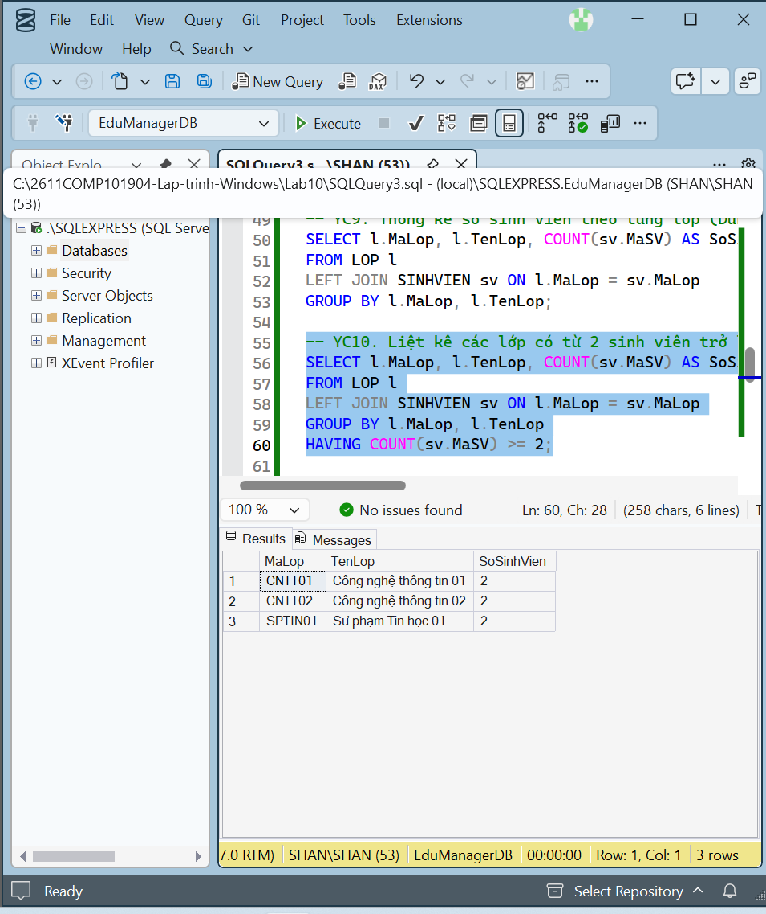

### Truy vấn 11 – Kiểm thử lỗi khi thêm sinh viên vào lớp không tồn tại
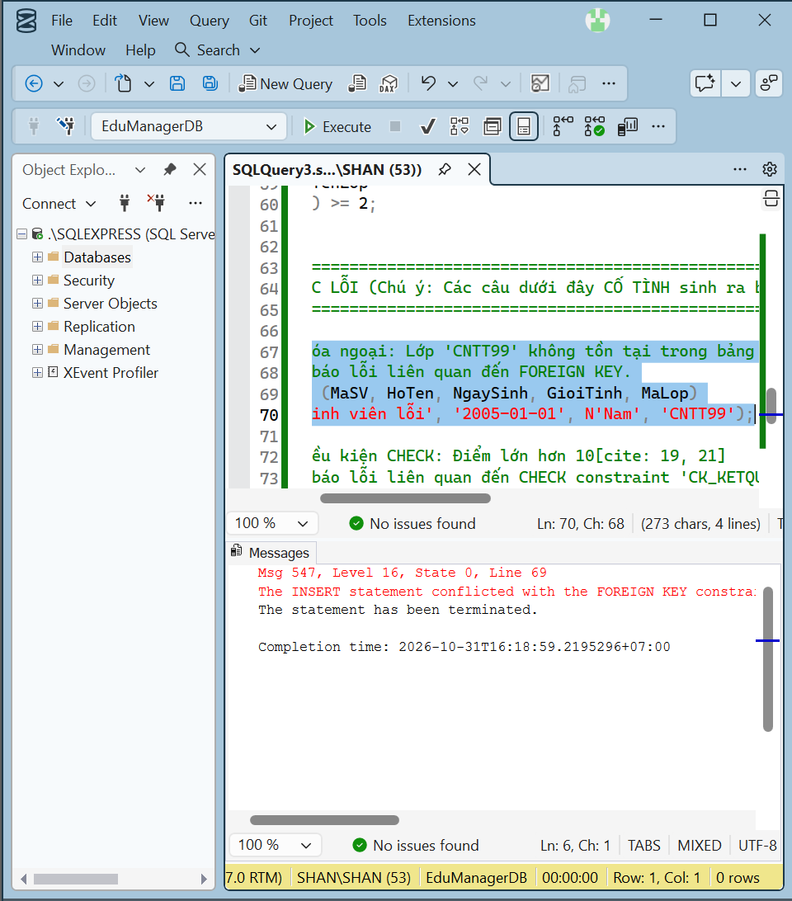

### Truy vấn 12 – Kiểm thử lỗi khi nhập điểm ngoài khoảng 0–10
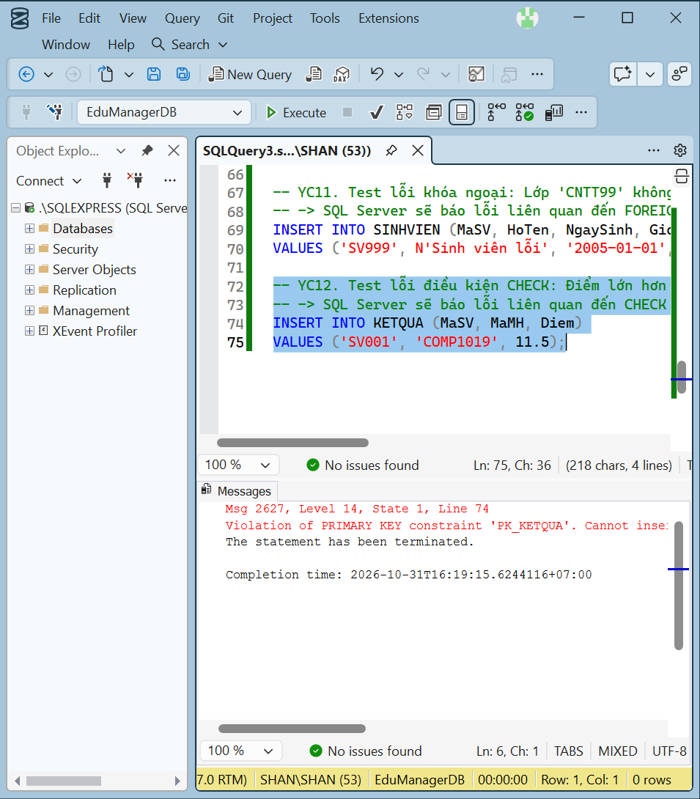

## 5. Danh sách tệp nộp
- `01_CreateDatabase.sql`: tạo database, bảng và ràng buộc.
- `02_InsertSampleData.sql`: nhập dữ liệu mẫu.
- `03_Queries.sql`: 12 truy vấn và kiểm thử.
- `README.md`: báo cáo ngắn và vị trí ảnh minh chứng.
- `images/`: 12 ảnh chụp kết quả thực tế.

## 6. Lưu ý
- Dữ liệu mẫu tối thiểu theo đề: 2 khoa, 3 lớp, 6 sinh viên, 4 môn học, 8 kết quả học tập và 2 tài khoản.
- Với truy vấn `UPDATE` và `DELETE`, nên kiểm tra dữ liệu trước/sau khi thực hiện để ảnh minh chứng thể hiện rõ kết quả.
- Hai truy vấn kiểm thử cuối cần thể hiện thông báo lỗi do vi phạm khóa ngoại hoặc ràng buộc `CHECK`. Hãy chạy thử có kiểm soát, không lưu thay đổi không mong muốn.
- Thay các ảnh khung chờ bằng ảnh chụp thật từ SSMS trước khi nộp.
