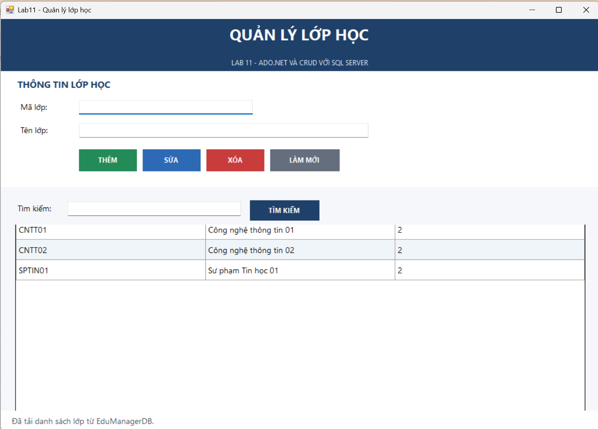
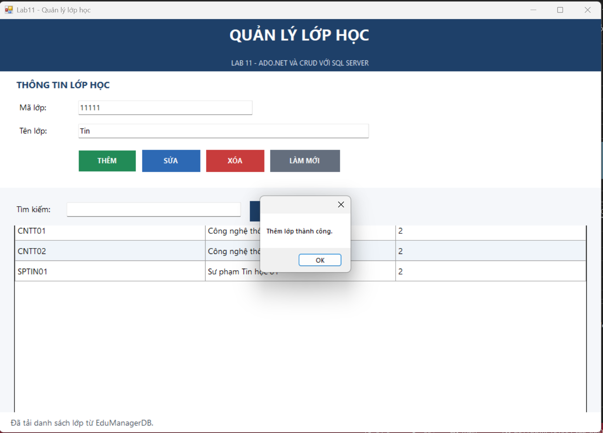
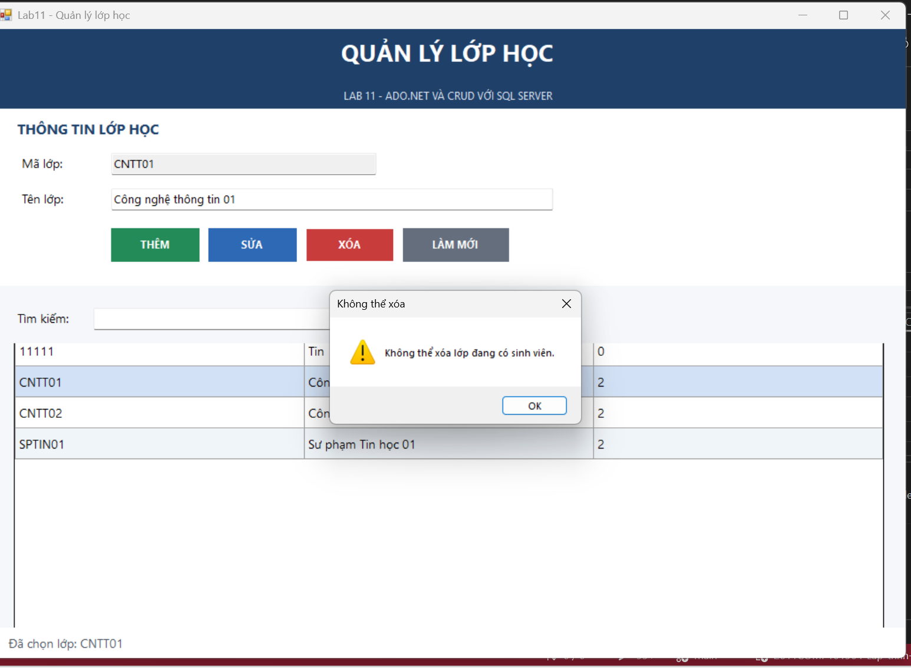

# Lab 11 - Ứng dụng Quản lý Lớp học (Windows Forms & ADO.NET)

## 1. Thông tin sinh viên
- **Họ và tên:** [Nhập họ và tên của bạn]
- **MSSV:** [Nhập mã số sinh viên của bạn]
- **Lớp học phần:** COMP1019 - Lập trình trên Windows
- **Giảng viên hướng dẫn:** ThS. Lê Thanh Thoại

---

## 2. Mô tả dự án Lab 11
Ứng dụng **Windows Forms (C#)** thực hiện chức năng quản lý lớp học, kết nối trực tiếp với cơ sở dữ liệu `EduManagerDB` trên SQL Server.
- **Kiến trúc:** Triển khai hoàn toàn bằng mã nguồn C# trong `FrmLop.cs`, không phụ thuộc vào `Form.Designer.cs`.
- **Thư viện:** Sử dụng gói `Microsoft.Data.SqlClient` qua NuGet.

---

## 3. Cấu hình kết nối (Connection String)
Chuỗi kết nối sử dụng trong ứng dụng (được khai báo tại file `FrmLop.cs`):
```csharp
private readonly string connectionString = @"Data Source=.\SQLEXPRESS;Initial Catalog=EduManagerDB;Integrated Security=True;TrustServerCertificate=True";
```

---

## 4. Chi tiết các chức năng CRUD & Ràng buộc
- **F1 (Load dữ liệu):** Tự động truy vấn kết hợp `LEFT JOIN` giữa `LOP` và `SINHVIEN` để hiển thị danh sách lớp kèm số lượng sinh viên lên `DataGridView`.
- **F2 (Chọn dòng):** Click chọn dòng để đổ dữ liệu tự động lên các ô nhập liệu `txtMaLop` và `txtTenLop`.
- **F3 (Thêm):** Thêm lớp học mới; kiểm tra dữ liệu trống và kiểm tra trùng mã lớp qua hàm đếm `ExecuteScalar`.
- **F4 (Sửa):** Cập nhật tên lớp theo mã lớp đang chọn.
- **F5 (Xóa):** Cảnh báo xác nhận trước khi xóa; **từ chối xóa** nếu lớp học vẫn còn sinh viên đang theo học.
- **F6 (Tìm kiếm):** Hỗ trợ tìm kiếm nhanh theo mã hoặc tên lớp bằng từ khóa `LIKE` kết hợp `SqlParameter` chống SQL Injection.
- **F7 (Làm mới):** Xóa trắng dữ liệu nhập, mở khóa ô mã lớp và tải lại toàn bộ bảng danh sách.

---

## 5. Minh chứng kết quả thực thi trên GitHub
*(Dưới đây là các đường dẫn ảnh minh họa khi đẩy lên GitHub Repository)*

### 5.1. Giao diện khởi chạy và tải dữ liệu từ SQL Server


### 5.2. Chức năng Thêm, Sửa và Tìm kiếm lớp học

### 5.3. Minh chứng kiểm thử ràng buộc (Chặn xóa lớp đang có sinh viên)
