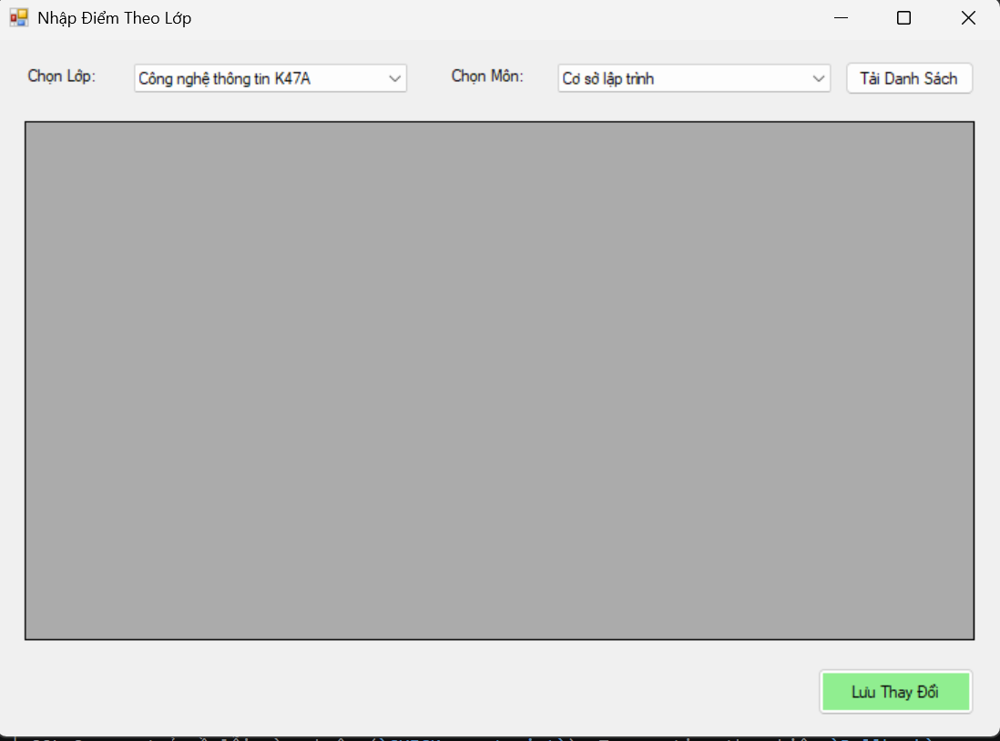
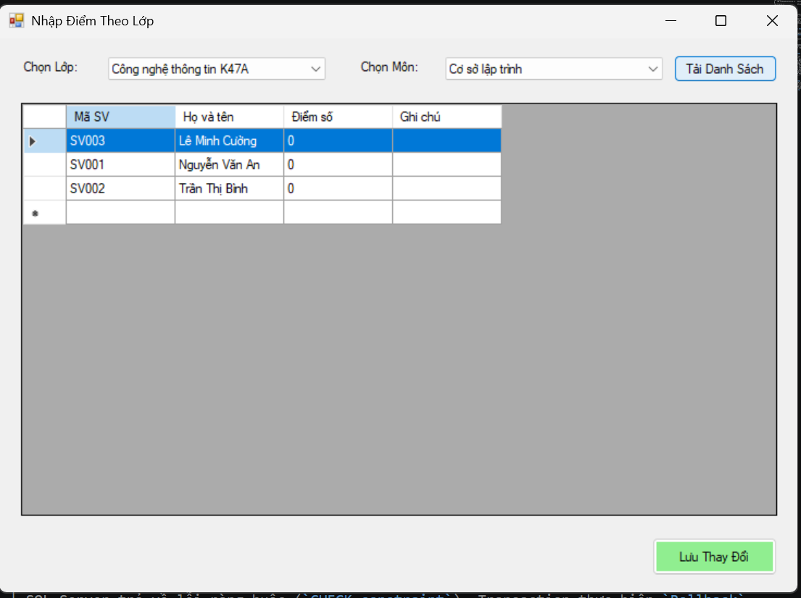
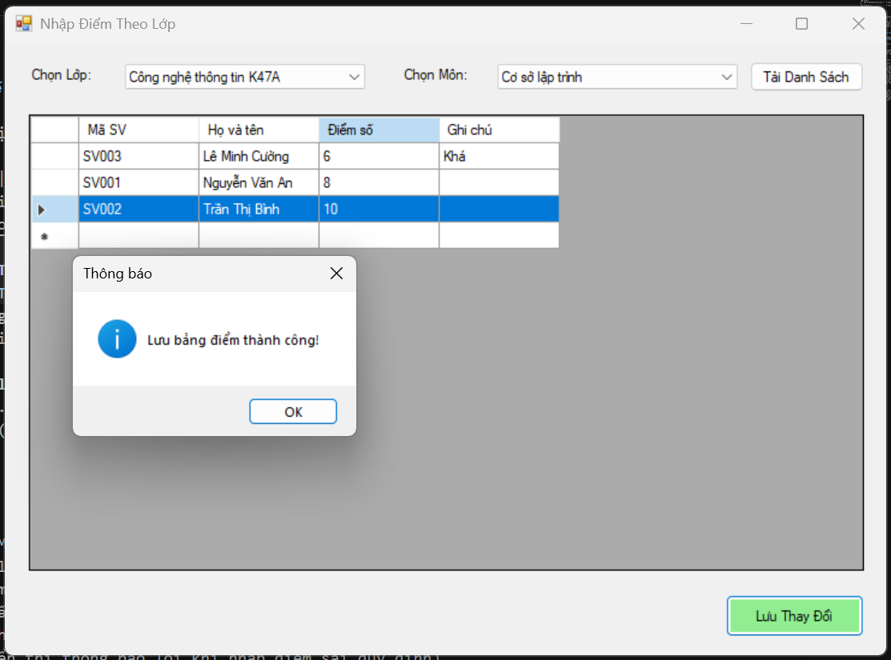
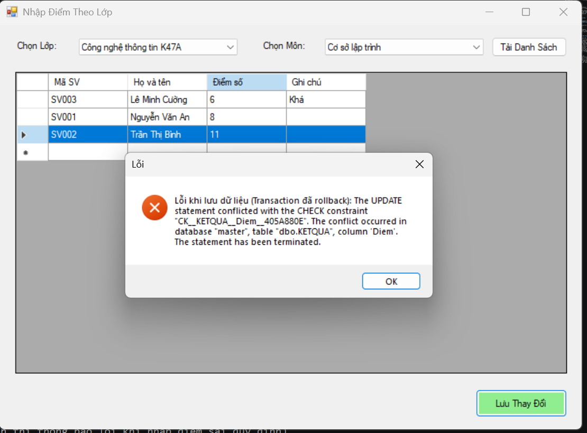

# Lab 12: Quản lý Điểm Sinh Viên theo Lớp (C# WinForms & SQL Server)

Ứng dụng Desktop quản lý điểm sinh viên được xây dựng bằng C# WinForms, áp dụng kiến trúc phân tầng (DAL), cơ chế giao dịch an toàn (`SqlTransaction`), quản lý dữ liệu bằng `BindingSource` và tương tác trực tiếp với cơ sở dữ liệu SQL Server thông qua các Stored Procedure.

---

## 📂 Cấu trúc Project
```text
Lab12/
│
├── Database/
│   └── QLSinhVienLab12.sql      # Script tạo CSDL, bảng dữ liệu mẫu và các Stored Procedure
│
├── DAL/
│   ├── Database.cs             # Cấu hình chuỗi kết nối SQL Server
│   └── KetQuaDAL.cs            # Tầng truy xuất dữ liệu & xử lý Transaction
│
├── Forms/
│   └── FrmNhapDiemTheoLop.cs   # Giao diện nhập điểm theo lớp & môn học
│
└── Program.cs                  # Điểm khởi chạy ứng dụng (Entry Point)
```

---

## 🛠️ Công nghệ sử dụng
* **Ngôn ngữ lập trình:** C#
* **Giao diện:** Windows Forms (WinForms - Thiết kế giao diện trực tiếp bằng code)
* **Hệ quản trị CSDL:** SQL Server, sử dụng thư viện `Microsoft.Data.SqlClient`
* **Kỹ thuật áp dụng:** 
  * Mô hình phân tầng dữ liệu (Data Access Layer - DAL)
  * Stored Procedures tối ưu hóa hiệu năng truy vấn
  * Cơ chế giao dịch an toàn dữ liệu (`SqlTransaction`)
  * Quản lý trạng thái dữ liệu thông qua `BindingSource`

---

## 🚀 Hướng dẫn Cài đặt & Chạy ứng dụng

1. **Thiết lập Cơ sở dữ liệu:**
   * Mở phần mềm **SQL Server Management Studio (SSMS)**.
   * Mở file `Database/QLSinhVienLab12.sql` và bấm **Execute** để khởi tạo CSDL, bảng dữ liệu và các Stored Procedure.

2. **Cấu hình kết nối:**
   * Mở file `DAL/Database.cs`, kiểm tra và điều chỉnh chuỗi kết nối `ConnectionString` cho phù hợp với tên Server của máy bạn (ví dụ: `Data Source=.\SQLEXPRESS...`).

3. **Chạy chương trình:**
   * Mở Solution trong **Visual Studio**.
   * Nhấn tổ hợp phím **Ctrl + Shift + B** để Build project.
   * Nhấn phím **F5** để khởi chạy ứng dụng.

---

## 🧪 Danh sách Test Cases & Minh họa thực tế

| STT | Tên Test Case | Mục đích kiểm thử | Kịch bản thực hiện | Kết quả mong đợi | Hình ảnh minh họa |
| :---: | :--- | :--- | :--- | :--- | :---: |
| **TC01** | **Tải danh sách lớp & môn học** | Kiểm tra việc đổ dữ liệu danh mục vào các ComboBox khi mở form. | Khởi động ứng dụng, quan sát ComboBox **Lớp** và **Môn Học**. | Hiển thị đầy đủ danh sách các lớp (*CTK47A*, *CTK47B*...) và môn học (*Lập trình trên Windows*...). |  |
| **TC02** | **Tải bảng điểm theo lớp & môn** | Kiểm tra hiển thị danh sách sinh viên tương ứng lên DataGridView. | Chọn lớp `CTK47A`, chọn môn `Lập trình trên Windows`, bấm nút **Tải Danh Sách**. | Hiển thị danh sách sinh viên của lớp kèm cột điểm và ghi chú; khóa cột Mã SV và Họ tên không cho sửa trực tiếp. |  |
| **TC03** | **Cập nhật & Lưu điểm (Thành công)** | Kiểm tra cơ chế `SqlTransaction` khi lưu điểm hợp lệ. | Nhập điểm mới cho sinh viên (ví dụ: `8.5`), bấm nút **Lưu Thay Đổi**. | Hiển thị thông báo **"Lưu bảng điểm thành công!"**, dữ liệu được cập nhật xuống CSDL an toàn. |  |
| **TC04** | **Kiểm tra ràng buộc dữ liệu (Validation)** | Kiểm tra ràng buộc điểm số trong khoảng từ 0 đến 10. | Nhập điểm vượt ngưỡng (ví dụ: `11` hoặc `-1`), bấm **Lưu Thay Đổi**. | SQL Server trả về lỗi ràng buộc (`CHECK constraint`), Transaction thực hiện `Rollback` và hiển thị thông báo lỗi chi tiết. |  |

---
